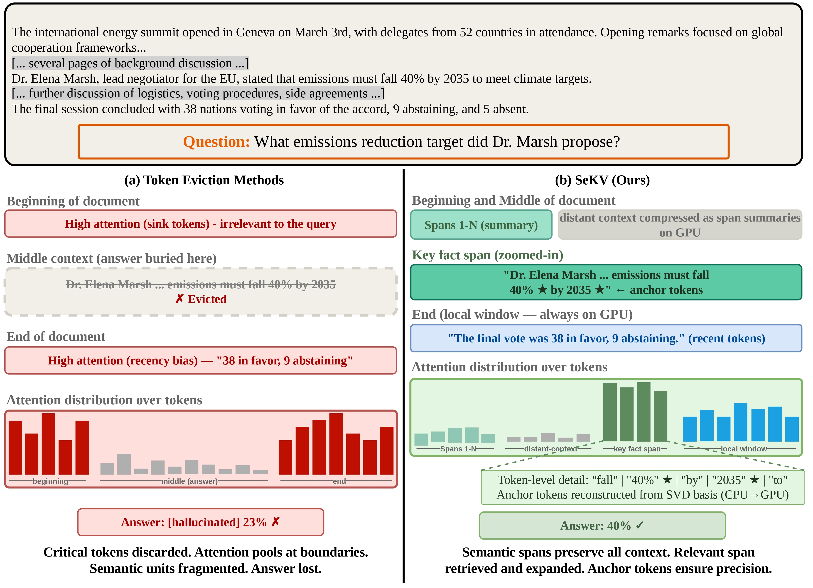
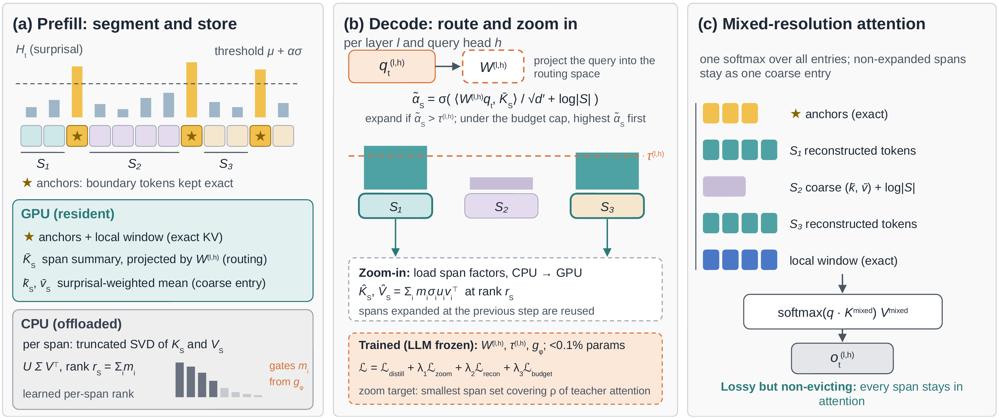

<div align="center">
  <h1>
    SeKV: Resolution-Adaptive KV Cache with Hierarchical Semantic Memory for Long-Context LLM Inference
  </h1>

  <p>
    <a href="https://arxiv.org/abs/2606.31145">
    
    </a>
    
    
    
    
  </p>
</div>

Resolution-adaptive KV cache with surprisal-based span memory, learned-rank low-rank storage, and a trained zoom-in mechanism.

Part of this work has been done during an internship at [Microsoft Research Asia Vancouver](https://www.microsoft.com/en-us/research/group/microsoft-research-asia-vancouver/).

<p align="center">
  
</p>

## Overview

Long-context generation is often memory-bound: the KV cache grows linearly with the context and dominates GPU memory during decoding. Token eviction discards entries permanently, and semantic compression fixes each unit's resolution at prefill, so detail that only becomes relevant for a later query cannot be recovered.

SeKV stores every part of the context at two resolutions and decides at decode time which parts to restore to token level. The context is split at high-surprisal positions; these anchor tokens and a local window of recent tokens stay exact on GPU. Each span between anchors keeps a routing summary and a coarse entry on GPU, and low-rank factors of its keys and values, with a learned per-span rank, on CPU.

At each decoding step, lightweight per-head routers score spans against the current query. Selected spans are reconstructed from their factors and attended at token resolution, while all other spans stay in attention as a single coarse entry. The cache is lossy but non-evicting: every span stays in one shared softmax. The base LLM is frozen, and the router adds under 0.1% parameters.

## Method

<p align="center">
  
</p>

SeKV combines four core pieces:

1. Surprisal-based segmentation: token surprisal $H_t = -\log p(x_t \mid x_{<t})$ is computed at prefill (with a chunked LM head). Positions with $H_t > \mu + \alpha\sigma$ become boundaries, and boundaries closer than $L_\text{gap}$ tokens are merged, keeping the highest-surprisal one. Boundary tokens are anchors kept as exact KV; spans shorter than $L_\text{min}$ also stay exact.
2. Span memory: on GPU, each span keeps a routing summary (keys projected by a learned per-head $W$ and averaged with surprisal weights) and a coarse entry (surprisal-weighted mean key and value). On CPU, each span keeps a truncated SVD (up to $R_\text{max}$) of its pre-RoPE keys and values. A predictor $g_\phi$ gates each singular component, and components with negligible gates are dropped, so the stored rank adapts per span.
3. Trained zoom-in: per query head, $\tilde\alpha_S = \sigma\big((Wq_t)^\top \bar K_S/\sqrt{d'} + \log|S|\big)$ is compared with a learned per-head threshold $\tau$. Under grouped-query attention, a span is reconstructed for a KV head if any query head in its group selects it. When the expansions exceed the GPU budget, spans are kept in decreasing $\tilde\alpha_S$ order until the budget is filled.
4. Mixed-resolution attention: anchors and the local window (exact), expanded spans (reconstructed, with RoPE re-applied at their original positions), and every other span as its coarse entry with a $+\log|S|$ score bias all share one softmax.

Training keeps the LLM frozen and optimizes $W$, $\tau$, and $g_\phi$ with $\mathcal{L} = \mathcal{L}_\text{distill} + \lambda_1\mathcal{L}_\text{zoom} + \lambda_2\mathcal{L}_\text{recon} + \lambda_3\mathcal{L}_\text{budget}$. Here, $\mathcal{L}_\text{distill}$ is a KL divergence to the full-KV teacher, with a straight-through estimator for the zoom decisions. $\mathcal{L}_\text{zoom}$ is a weighted BCE toward the smallest span set covering $\rho$ of the teacher's attention. $\mathcal{L}_\text{recon}$ is the gated spectral error, and $\mathcal{L}_\text{budget}$ is the expansion and rank cost.

## Supported Models

| Key | HF id | L | H | H_kv | d_h |
|---|---|---:|---:|---:|---:|
| `llama-3.2-3b` | [meta-llama/Llama-3.2-3B-Instruct](https://huggingface.co/meta-llama/Llama-3.2-3B-Instruct) | 28 | 24 | 8 | 128 |
| `llama-3-8b-base` | [meta-llama/Meta-Llama-3-8B](https://huggingface.co/meta-llama/Meta-Llama-3-8B) | 32 | 32 | 8 | 128 |
| `llama-3.1-8b` | [meta-llama/Llama-3.1-8B-Instruct](https://huggingface.co/meta-llama/Llama-3.1-8B-Instruct) | 32 | 32 | 8 | 128 |
| `mistral-7b` | [mistralai/Mistral-7B-Instruct-v0.3](https://huggingface.co/mistralai/Mistral-7B-Instruct-v0.3) | 32 | 32 | 8 | 128 |
| `qwen2.5-14b` | [Qwen/Qwen2.5-14B-Instruct](https://huggingface.co/Qwen/Qwen2.5-14B-Instruct) | 48 | 40 | 8 | 128 |

Only the routing projections, thresholds, and rank-gate predictor are trained: 2.8M to 7.9M parameters (about 0.05 to 0.09% of the backbone). The backbone weights remain frozen.

## Repository Structure

```text
SeKV/
├── pyproject.toml                # Package metadata, dependencies, and CLI entry points.
├── scripts/
│   ├── train.sh                  # Training launcher wrapper for sekv-train.
│   └── generate.sh               # Generation launcher wrapper for sekv-generate.
├── misc/
│   ├── teaser.jpg                # Teaser figure used in this README.
│   └── method.png                # Method overview figure used in this README.
└── sekv/
    ├── __init__.py               # Top-level package exports.
    ├── config.py                 # Typed config dataclasses + YAML loading/validation.
    ├── backbone.py               # Frozen backbone load, model registry/spec, prefill (K/V, chunked surprisal).
    ├── rope.py                   # RoPE apply/invert helpers (pre-RoPE key factorization).
    ├── segmentation.py           # Surprisal boundaries, L_gap merging, anchors/spans, local-window layout.
    ├── modules.py                # Trainable SeKV modules (routing W, thresholds tau, rank gates g_phi).
    ├── memory.py                 # Span memory: coarse entries, learned-rank SVD factors, window, reconstruction.
    ├── attention.py              # Per-head routing, budgeted zoom-in, mixed-resolution single softmax.
    ├── teacher.py                # Full-KV teacher attention at sampled queries and rho-coverage targets.
    ├── losses.py                 # Distill/zoom/recon/budget losses and total weighting.
    ├── data.py                   # Streaming RedPajama dataset and curriculum helpers.
    ├── train.py                  # SeKV training loop, optimization, checkpointing, CLI.
    ├── generate.py               # Checkpoint load, budgeted decode, zoom cache (async transfer + reuse), CLI.
    ├── arch/
    │   ├── __init__.py           # Adapter exports + factory.
    │   ├── base.py               # Architecture adapter interface for explicit layer substitution.
    │   ├── llama.py              # Llama-family adapter implementation.
    │   ├── mistral.py            # Mistral adapter implementation.
    │   └── qwen2.py              # Qwen2 adapter implementation.
    ├── eval/
    │   ├── __init__.py           # Eval package exports.
    │   ├── registry.py           # Benchmark interface + registry.
    │   ├── metrics.py            # Metric functions and task mappings.
    │   ├── efficiency.py         # KV residency / expansion / memory tracking.
    │   ├── benchmarks.py         # LongBench, RULER, NIAH, InfiniteBench, GSM8K adapters.
    │   └── run_eval.py           # Eval orchestrator CLI across benchmarks and budgets.
    └── configs/
        └── default.yaml          # Default training/generation/eval configuration.
```

## Installation

1. Clone and enter the repository.

```bash
git clone https://github.com/AmirAbaskohi/SeKV
cd SeKV
```

2. Create a Python 3.10+ environment.

```bash
python3 -m venv .venv
source .venv/bin/activate
python -V
```

3. Install SeKV in editable mode.

```bash
pip install -e .
```

4. Authenticate with Hugging Face if you will use gated checkpoints (for example, Llama and Mistral).

```bash
huggingface-cli login
```

Notes:
- The project pins Transformers to `>=4.44,<4.58` in `pyproject.toml`.
- Practical training budget: the router is trained once per backbone, which takes about 1.8 to 5.2 hours on a single 8xA100 (80GB) node (Qwen2.5-14B is at the upper end).

## Configuration

All core knobs live in `sekv/configs/default.yaml`. The file defines model loading, segmentation, memory/routing modules, losses, training schedule, output paths, and evaluation settings.

```yaml
model:
  name: llama-3.2-3b
  dtype: bfloat16
  device_map: auto
  attn_implementation: sdpa

segmentation:
  alpha: 1.0          # boundary threshold mu + alpha * sigma on surprisal
  l_gap: 64           # boundaries closer than this are merged (highest surprisal kept)
  l_min: 16           # spans shorter than this stay exact on GPU

memory:
  r_max: 32           # max SVD rank per span (keys and values)
  summary_dim: 32     # routing space dimension d'
  local_window: 512   # recent tokens kept as exact KV (w)
  gate_eps: 0.05      # singular components with gate below this are not stored

routing:
  tau_init: 0.05      # permissive initial thresholds so spans expand early
  ste_temperature: 0.1

loss:
  lambda_zoom: 1.0
  lambda_recon: 0.5
  lambda_budget: 0.1  # annealed from 0 over the first half of training
  beta: 0.1           # cost of retained rank relative to expanded spans
  w_pos: 10.0         # up-weight of relevant spans in the zoom BCE
  rho: 0.9            # teacher attention coverage for zoom targets

train:
  lr: 1.0e-3
  max_steps: 3000
  batch_size: 8
  curriculum: [8192, 16384, 32768]
  query_candidates: 128  # query positions scored per sequence
  queries_per_seq: 16    # positions kept (most attention outside the local window)

paths:
  output_dir: outputs
  checkpoint_dir: checkpoints
```

You can override key options from CLI (for example model choice):

```bash
sekv-train --config sekv/configs/default.yaml --model llama-3.1-8b
```

## Training

Use the training wrapper script:

```bash
bash scripts/train.sh            # uses defaults
MODEL=qwen2.5-14b bash scripts/train.sh
```

What it does:
- Calls `sekv-train` with the selected config/model.
- Streams long RedPajama documents (arXiv, books, code) with curriculum sequence lengths `8192 -> 16384 -> 32768`.
- For each sequence, picks query positions whose full-KV teacher attention falls mostly outside the local window, and trains the router on them against the frozen backbone.
- Saves checkpoints every 200 steps to `<checkpoint_dir>/<model>/step_XXXXXXX.pt` and the final one to `<checkpoint_dir>/<model>/final.pt`.
- Prints periodic logs including total loss and components (`distill`, `zoom`, `recon`, `budget`), plus `mean_effective_rank` and `mean_expansion_rate`.

You can also pass explicit flags to the script:

```bash
bash scripts/train.sh --config sekv/configs/default.yaml --model llama-3.1-8b
```

## Generation / Using a Trained Model

Use the generation wrapper with a prompt and checkpoint:

```bash
bash scripts/generate.sh --prompt "Summarize the following ..." \
  --checkpoint checkpoints/llama-3.1-8b/final.pt --budget 0.1 --max-new-tokens 256
```

Behavior notes:
- `--budget` caps the peak GPU-resident KV per decoding step: anchors, local window, summaries, coarse entries, and reconstructed spans. A value up to `1` is a fraction of Full KV (`0.1` = the 10% setting used in the paper). A larger value is an absolute cap in tokens per KV head per layer, and `none` disables the cap.
- If the resident state alone does not fit in the budget (very short inputs or very small budgets), generation raises `BudgetTooSmallError`. Such inputs fall outside SeKV's operating range.
- Decoding is greedy (`temperature = 0` behavior via argmax).
- Pass `--apply-chat-template` to wrap the prompt with the chat template of instruct checkpoints. Base checkpoints (for example `llama-3-8b-base`) are always run without it.

## Evaluation

Run benchmarks (LongBench, RULER, NIAH, InfiniteBench, GSM8K) across one or more budgets:

```bash
sekv-eval --config sekv/configs/default.yaml --eval-config sekv/configs/default.yaml \
  --checkpoint checkpoints/llama-3.1-8b/final.pt --model llama-3.1-8b \
  --benchmarks longbench,niah --budgets 0.05,0.1,0.2
```

Results are written to `eval.output_dir` (default `outputs/eval`) as one JSON per benchmark and budget, plus `combined_results.json`. Each file reports the aggregate score and efficiency statistics: resident KV, expansion rate, stored rank, host-to-device bytes per step, and span reuse. It also lists the inputs that were excluded because the resident state could not fit in the budget.

## How It Works at Runtime

Each request flows through these stages:

1. Prefill: run the frozen backbone over the prompt, collect per-layer K/V, and compute token surprisal with a chunked LM head.
2. Surprisal segmentation: mark high-surprisal boundaries, merge those closer than `l_gap`, and split the prompt into anchors and spans. The last `local_window` tokens form the exact local window.
3. Span memory build: keep anchors, the window, routing summaries, and coarse entries on GPU. Factorize each span's pre-RoPE keys and values, apply the learned rank gates, and offload the kept factors to CPU.
4. Per-step routing: each query head scores every span, $\tilde\alpha_S$, against its learned threshold. A span is reconstructed for a KV head if any query head in its group selects it, highest $\tilde\alpha_S$ first under the budget.
5. Zoom-in: fetch only the selected spans' factors for that KV group (pinned memory, side stream), reconstruct them, and re-apply RoPE at their original positions. Spans expanded at the previous step stay on GPU and are reused.
6. Mixed-resolution single softmax: each head attends once over anchors, the local window, its reconstructed spans, and the coarse entries of all other spans.
7. Generated tokens join the local window. When it grows past `local_window + l_gap`, its oldest `l_gap` tokens become a new span, so the window stays bounded without evicting anything.

## Citation
```
@misc{abaskohi2026sekvresolutionadaptivekvcache,
      title={SeKV: Resolution-Adaptive KV Cache with Hierarchical Semantic Memory for Long-Context LLM Inference}, 
      author={Amirhossein Abaskohi and Giuseppe Carenini and Peter West and Yuhang He},
      year={2026},
      eprint={2606.31145},
      archivePrefix={arXiv},
      primaryClass={cs.CL},
      url={https://arxiv.org/abs/2606.31145}, 
}
```

## License

Released under the [MIT License](LICENSE).
